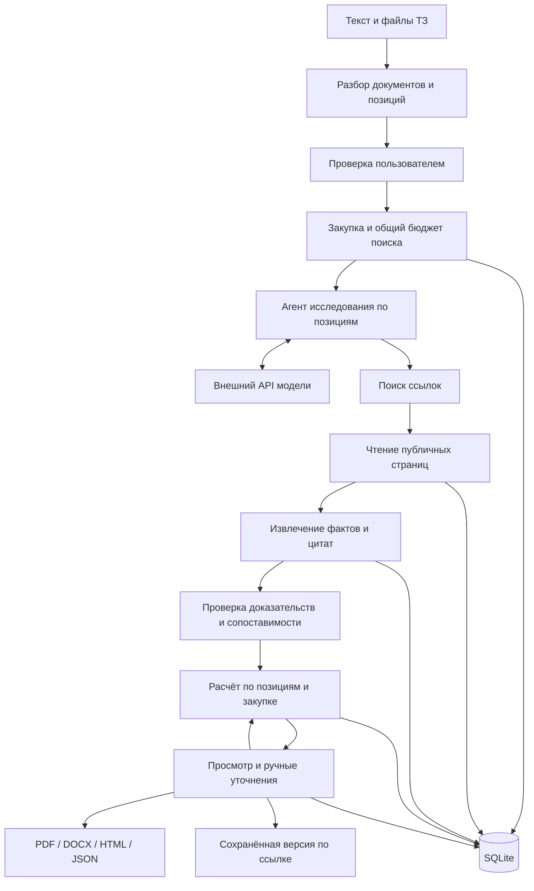

# Архитектура QuoteLens

QuoteLens — одно серверное приложение на Python с браузерным интерфейсом без отдельной сборки. Оно разбирает многопозиционное ТЗ, выполняет ограниченный поиск публичных предложений, сохраняет доказательства и строит проверяемый расчёт. SQLite хранится в постоянном томе; Chromium используется для страниц с JavaScript и экспорта PDF.

## Поток данных

1. `POST /api/prepare` принимает текст и файлы DOCX/TXT/MD/PDF. Извлекает текст, позиции, количества, единицы, требования и общие условия. PDF должен содержать текстовый слой; отсутствие текста сообщает о необходимости OCR. Пользователь проверяет разбор до поиска. Исходные цитаты и ручные значения различаются.
2. `POST /api/search` создаёт фоновое исследование с проверенными `items`, исходными `input_documents`, областью `source_scope` и условием `search_policy`. Позиции исследуются последовательно в пределах общего бюджета закупки.
3. Агент может вызвать `search_web`, `open_page`, `read_document`, `search_saved`, `record_offer`, `finish`. Модель управляет исследованием; её утверждение само по себе не подтверждает цену. Ранний `finish` не завершает многопозиционный поиск, если ещё есть работа в рамках выбранного условия и бюджета.
4. Поиск даёт адреса кандидатов. Основной путь использует DuckDuckGo; резерв Exa доступен через OpenRouter. Карточка читается отдельно по HTTPS, при необходимости через Chromium. Каталог служит для обнаружения карточек и не считается одним предложением с ценой первой плитки.
5. Из карточки извлекаются цена, валюта, единица, упаковка, характеристики и сведения о поставщике. Сохраняются URL, время, текст/HTML, хеш и точные подтверждающие фрагменты. Предложение проверяется и сохраняется до следующего модельного действия.
6. Код проверяет доказательства, обязательные характеристики, налоговые условия, единицы и дубли. Предложение получает решение с причинами: включено, исключено либо требует проверки. Модельная оценка релевантности хранится отдельно и не отменяет строгие проверки.
7. Расчёт и причина остановки сохраняются в результате. `GET /api/jobs/ID` возвращает состояние исследования. История хранится на сервере; после перезапуска незавершённый запуск остаётся прерванным без автоматического платного повтора.
8. Ручное уточнение или исключение создаёт новую ревизию с пересчётом. Сохраняются исходные значения и история решения; конфликт версий не перезаписывается молча. Выгрузки строятся из сохранённой ревизии всей закупки, независимо от фильтров интерфейса.

## Ключевые компоненты

| Компонент | Ответственность |
| --- | --- |
| `static/` | Ввод ТЗ, проверка позиций, параметры исследования, история, предложения и доказательства. |
| `quotelens/server.py` | HTTP API, валидация входа, фоновые задания, операции проверки и экспорт. |
| `spec_ingest.py` | Чтение файлов, разбор позиций и нормализация пользовательских исправлений. |
| `procurement.py` | Последовательная обработка позиций и общий бюджет исследования. |
| `agent.py`, `providers.py` | Цикл вызовов инструментов, контекст, подключение модели и учёт расхода. |
| `acquisition.py`, `source_documents.py` | Ограниченная загрузка публичных страниц, Chromium и различение типов документов. |
| `extraction.py`, `source_adapters.py` | Извлечение данных карточек и адаптация к структуре сайтов. |
| `source_policy.py`, `source_presets.py` | Область поиска и именные группы источников; выбор домена не означает подключённый официальный API. |
| `engine.py`, `selection.py`, `targeting.py` | Доказательства, сопоставимость, дедупликация, расчёты и проверка профиля. |
| `storage.py` | SQLite, документы, полнотекстовый поиск, события, ревизии и квоты. |
| `reports.py`, `sharing.py` | PDF/DOCX/HTML/JSON и отдельная сохранённая версия для передачи по ссылке. |

Повторное исследование может использовать историю для обнаружения подходящих URL. Старые цены при этом не становятся свежими: карточки читаются заново. Режим `snapshot` отдельно воспроизводит сохранённый набор и сохраняет его происхождение.

## Сопоставимость и арифметика

В строгий расчёт входят предложения с подтверждёнными обязательными признаками и сопоставимыми условиями. Подтверждённое несоответствие исключается; отсутствие необходимого значения требует проверки. Неизвестный НДС не означает отсутствие НДС, неизвестная доставка не равна нулю. Коробка переводится в пачки только по подтверждённому составу упаковки.

Денежные операции используют `Decimal`. Базовый профиль — RUB, сопоставимые цены с НДС, без добавления неизвестной доставки. Цена единицы равна среднему принятых нормализованных цен; стоимость позиции — среднее × количество. Выборочное стандартное отклонение делит сумму квадратов отклонений на `n−1`; CV = отклонение / среднее × 100. При `n < 2` CV не определён.

Профиль готовности `target` требует минимум три разных идентифицированных поставщика для каждой позиции и CV ≤ 33%. Коэффициент рассчитывается по **всем** сопоставимым предложениям. Это профиль расчёта продукта; применимость метода к конкретной закупке проверяет специалист. Разные домены не доказывают юридическую независимость продавцов.

При пяти и более сопоставимых ценах IQR служит диагностикой: границы равны Q1 − 1,5 × IQR и Q3 + 1,5 × IQR. Аномалия показывается с объяснением; дорогая цена не удаляется автоматически.

`calculation.provisional` хранит предварительную оценку отдельно от строгого результата. В ней возможны явно указанные допущения, например цена за пачку с подтверждённой фасовкой при неизвестной исходной единице продажи. Итог закупки различает рассчитанные и пропущенные позиции: частичная сумма не выдаётся за полную стоимость.

## Условия завершения и квоты

Параметр `search_policy` поддерживает три режима:

| Режим | Условие |
| --- | --- |
| `target` | Готовность каждой позиции по профилю; по умолчанию максимум 600 секунд. |
| `offers` | Указанное число уникальных релевантных карточек с подтверждённой ценой, максимум 100 на закупку. Неполные условия могут требовать проверки. |
| `time` | Указанное время исследования; найденные предложения сохраняются. |

Для каждого режима действует время от 1 до 3600 секунд. При незаданном времени `offers`/`time` используют 3600 секунд. Дополнительно могут действовать пределы стоимости и токенов исследования, квоты сервиса, отмена и доступность источников. Исчерпание найденных ссылок или ошибка провайдера может завершить работу раньше; причина сохраняется, полнота рынка не заявляется.

API-запросы без `search_policy` ограничены 16 страницами, 6 поисковыми запросами, 10 вызовами модели и 240 секундами. При заданном `search_policy` бюджет закупки определяется выбранным режимом. Накопительные квоты и резерв стоимости действуют в обоих случаях; настройка описана в [конфигурации](configuration.md).

## Развёртывание и границы доступа

Compose запускает один контейнер: Python API, статические файлы и Chromium. Порт по умолчанию доступен на `127.0.0.1:8765`; SQLite находится в томе `results`, ключ — в файле, подключённом только для чтения. Контейнер работает без root, с файловой системой только для чтения и временным `/tmp`.

Для внешнего размещения оператор настраивает HTTPS-вход и необходимые ограничения доступа. Готовой системы персональных учётных записей нет. Сохранённая ссылка предназначена для передачи результата: любой получивший её может открыть эту версию.

Загрузчик разрешает публичные HTTPS-адреса и проверяет переходы и браузерные запросы. Локальные сети, адреса с секретами, произвольный исполняемый код модели и обход CAPTCHA не поддерживаются. Текст страницы считается данными, а не инструкцией агенту.

ЕИС/ГИСП и другие площадки могут быть областью обычного веб-поиска; полноценные специализированные коннекторы и работа после авторизации не реализованы. Входящие текстовые PDF поддерживаются, OCR и универсальное чтение PDF предложений поставщиков — нет. Новые категории могут требовать доразметки и проверки специалистом.

Пользовательские сценарии — в [scenarios.md](scenarios.md), запуск — в [README](../README.md).
